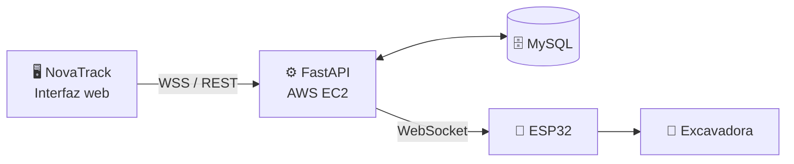

<!-- ===================================================================
     README de perfil · Victor López · VictorLopez19
     v2 · Tema claro/oscuro con <picture> + prefers-color-scheme
     =================================================================== -->

  

  

<table align="center">
  <tr>
    <td align="center" width="25%"><b>🎓 Formación</b> Ing. en Sistemas Computacionales TecNM · Pachuca</td>
    <td align="center" width="25%"><b>🎯 Enfoque</b> Backend · IoT Redes · Cloud</td>
    <td align="center" width="25%"><b>🏅 Certificado</b> AWS Academy Cisco</td>
    <td align="center" width="25%"><b>🌎 Idiomas</b> Español nativo Inglés B1</td>
  </tr>
</table>

## 🚀 Sobre mí

Soy estudiante de **Ingeniería en Sistemas Computacionales** y me gusta construir soluciones que **conectan mundos distintos**: APIs y bases de datos en la nube, comunicación en tiempo real y dispositivos físicos que reaccionan a lo que pasa en el software.

<table>
  <tr>
    <td align="center" width="33%" valign="top">
      <h3>⚙️ Backend</h3>
      APIs REST y WebSocket con <b>Python y FastAPI</b>, bases de datos relacionales y procedimientos almacenados.
    </td>
    <td align="center" width="33%" valign="top">
      <h3>🤖 IoT</h3>
      Sistemas embebidos con <b>ESP32</b>, control en tiempo real y comunicación bidireccional con la nube.
    </td>
    <td align="center" width="33%" valign="top">
      <h3>🌐 Redes y Cloud</h3>
      Redes <b>IPv4/IPv6, VLAN y Cisco</b>; despliegue de servicios y aplicaciones en <b>AWS</b>.
    </td>
  </tr>
</table>

🧠 Además exploro cómo aplicar inteligencia artificial en sistemas tecnológicos y de automatización.

## 🧰 Stack

<table align="center">
  <tr>
    <td align="right"><b>Lenguajes</b></td>
    <td><picture><source media="(prefers-color-scheme: dark)" srcset="https://skillicons.dev/icons?i=python,js,php,html,css&theme=dark"><source media="(prefers-color-scheme: light)" srcset="https://skillicons.dev/icons?i=python,js,php,html,css&theme=light"></picture></td>
  </tr>
  <tr>
    <td align="right"><b>Backend y web</b></td>
    <td><picture><source media="(prefers-color-scheme: dark)" srcset="https://skillicons.dev/icons?i=fastapi,react,bootstrap&theme=dark"><source media="(prefers-color-scheme: light)" srcset="https://skillicons.dev/icons?i=fastapi,react,bootstrap&theme=light"></picture></td>
  </tr>
  <tr>
    <td align="right"><b>Bases de datos</b></td>
    <td><picture><source media="(prefers-color-scheme: dark)" srcset="https://skillicons.dev/icons?i=mysql,sqlite&theme=dark"><source media="(prefers-color-scheme: light)" srcset="https://skillicons.dev/icons?i=mysql,sqlite&theme=light"></picture></td>
  </tr>
  <tr>
    <td align="right"><b>IoT y cloud</b></td>
    <td><picture><source media="(prefers-color-scheme: dark)" srcset="https://skillicons.dev/icons?i=aws,arduino,docker,linux&theme=dark"><source media="(prefers-color-scheme: light)" srcset="https://skillicons.dev/icons?i=aws,arduino,docker,linux&theme=light"></picture></td>
  </tr>
  <tr>
    <td align="right"><b>Herramientas</b></td>
    <td><picture><source media="(prefers-color-scheme: dark)" srcset="https://skillicons.dev/icons?i=git,github,vscode&theme=dark"><source media="(prefers-color-scheme: light)" srcset="https://skillicons.dev/icons?i=git,github,vscode&theme=light"></picture></td>
  </tr>
  <tr>
    <td align="right"><b>Redes</b></td>
    <td>
      
      
      
      
      
    </td>
  </tr>
</table>

## 💼 Proyectos

Mis dos proyectos principales de IoT comparten una misma arquitectura: una interfaz web, un backend en FastAPI desplegado en AWS y un dispositivo ESP32 que ejecuta las órdenes.

 

<!-- ============================ 01 · NovaTrack ============================ -->

**Plataforma web para controlar una excavadora física en tiempo real**

<table>
  <tr>
    <td width="55%" valign="top">

**✨ Modos de control**
- 🕹️ Joystick virtual
- 🎙️ Comandos por voz con IA
- ✋ Gestos mediante cámara
- 📱 Giroscopio del dispositivo

**🔧 Características técnicas**
- ⚡ Comunicación bidireccional con **WebSocket seguro (WSS)**
- ▶️ Secuencias DEMO ejecutables y cancelables
- 📡 Reconexión automática y supervisión de conectividad

</td>
    <td width="45%" valign="top">

**🧩 Tecnologías**

  

</td>
  </tr>
</table>

 

<!-- ============================ 02 · API ============================ -->

**Backend REST y WebSocket para administrar vehículos IoT**

<table>
  <tr>
    <td width="55%" valign="top">

**✨ Qué gestiona**
- 🚗 Vehículos, comandos, movimientos y demostraciones
- 📡 Comunicación con dispositivos ESP32

**🔧 Características técnicas**
- 🔌 Endpoints REST para las operaciones del sistema
- 🔄 WebSocket bidireccional
- 🗄️ MySQL con procedimientos almacenados
- ☁️ Despliegue en **AWS EC2**
- 🔐 Endpoints protegidos con API Key
- 📖 Documentación con Swagger

</td>
    <td width="45%" valign="top">

**🧩 Tecnologías**

  

</td>
  </tr>
</table>

 

<!-- ============================ 03 · Ecobot ============================ -->

**Clasificación inteligente de residuos con visión artificial**

<table>
  <tr>
    <td width="55%" valign="top">

**✨ Qué hace**
- 👁️ Reconoce objetos mediante visión artificial
- 🧠 Clasifica **plástico, metal, vidrio y papel** con TensorFlow

**🔧 Hardware**
- 🦾 Servomotores MG996R controlados con ESP32
- 📷 Captura y procesamiento de imágenes con webcam

</td>
    <td width="45%" valign="top">

**🧩 Tecnologías**

  

</td>
  </tr>
</table>

 

<!-- ============================ 04 · Redes ============================ -->

**Diseño e implementación de redes empresariales en Cisco Packet Tracer**

<table>
  <tr>
    <td width="55%" valign="top">

**✨ Qué practico**
- 🔀 Configuración de routers y switches Cisco
- 🌐 Direccionamiento IPv4 e IPv6
- 🧩 Segmentación con VLAN
- 📡 Interfaces y servicios de red
- 🔌 Topologías LAN
- 🛠️ Diagnóstico y solución de problemas de conectividad

</td>
    <td width="45%" valign="top">

**🧩 Tecnologías**

</td>
  </tr>
</table>

## 🎓 Certificaciones

<table align="center">
  <tr>
    <td align="center" width="33%" valign="top">
      <h3>☁️</h3>
      <b>AWS Academy Graduate</b> Cloud Foundations
    </td>
    <td align="center" width="33%" valign="top">
      <h3>🛡️</h3>
      <b>Cisco</b> Junior Cybersecurity Analyst Career Path
    </td>
    <td align="center" width="33%" valign="top">
      <h3>🌐</h3>
      <b>Cisco · CCNA</b> Fundamentos de Conmutación, Enrutamiento y Redes Inalámbricas
    </td>
  </tr>
</table>

## 📊 Estadísticas

<picture>
  <source media="(prefers-color-scheme: dark)" srcset="https://github-readme-stats.vercel.app/api?username=VictorLopez19&show_icons=true&theme=github_dark&hide_border=true&include_all_commits=true&bg_color=00000000">
  <source media="(prefers-color-scheme: light)" srcset="https://github-readme-stats.vercel.app/api?username=VictorLopez19&show_icons=true&theme=default&hide_border=true&include_all_commits=true&bg_color=00000000">
  
</picture>
<picture>
  <source media="(prefers-color-scheme: dark)" srcset="https://github-readme-stats.vercel.app/api/top-langs/?username=VictorLopez19&layout=compact&theme=github_dark&hide_border=true&bg_color=00000000">
  <source media="(prefers-color-scheme: light)" srcset="https://github-readme-stats.vercel.app/api/top-langs/?username=VictorLopez19&layout=compact&theme=default&hide_border=true&bg_color=00000000">
  
</picture>

<picture>
  <source media="(prefers-color-scheme: dark)" srcset="https://streak-stats.demolab.com?user=VictorLopez19&theme=github-dark-blue&hide_border=true&background=00000000">
  <source media="(prefers-color-scheme: light)" srcset="https://streak-stats.demolab.com?user=VictorLopez19&theme=default&hide_border=true&background=00000000">
  
</picture>

<picture>
  <source media="(prefers-color-scheme: dark)" srcset="https://github-readme-activity-graph.vercel.app/graph?username=VictorLopez19&theme=tokyo-night&hide_border=true&area=true&bg_color=00000000">
  <source media="(prefers-color-scheme: light)" srcset="https://github-readme-activity-graph.vercel.app/graph?username=VictorLopez19&theme=github-light&hide_border=true&area=true&bg_color=00000000">
  
</picture>

## 🤝 Contacto

Me interesa colaborar en proyectos de **desarrollo de software, IoT, redes y cloud**, y compartir lo que voy aprendiendo.

<!-- Reemplaza TU-USUARIO por tu perfil de LinkedIn -->

  

**💻 Transformando ideas en soluciones tecnológicas**

